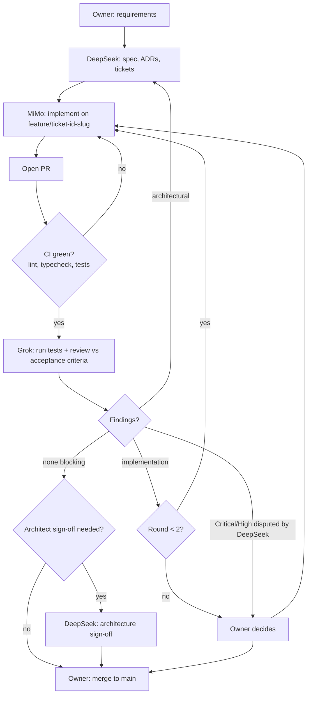

# Development Workflow — Multi-Model (DeepSeek / MiMo / Grok)

This repo is built phase by phase (Phase 0–8, see `BUILD_PLAN.md`) by three AI models with strictly separated roles, supervised by the human owner. Models do not share chat history: **all shared memory lives in this repository** (specs, ADRs, tickets, findings, role prompts).

Start every session by reading `AGENTS.md` and your role prompt in `prompts/roles/`.

## 1. Roles

| Role | Model | Responsibilities | Must not |
|---|---|---|---|
| Lead Architect | DeepSeek | Architecture, DB schemas (`DATA_MODEL.md`), API contracts (`API_CONTRACTS.md`), workflow engine / node execution design, ADRs, breaking features into tickets, hard bugs, architectural refactors, checking changes follow the design. Writes spec and tickets **before** implementation. | Implement routine tickets; grade its own work on disputed Critical/High findings; merge. |
| Implementation Engineer | MiMo | React components, screens, node editor, backend endpoints, migrations, model adapters, unit/integration tests, docs — only from explicit tickets with acceptance criteria. | Make architectural decisions (even "because it's easier"); change contracts/schemas outside the ticket; merge. If the spec seems wrong → raise a question, don't deviate. |
| Independent QA / Red Team | Grok | Reviews PRs: security, architectural inconsistencies, unnecessary complexity, missing edge cases, acceptance criteria, broken assumptions in the workflow engine. Runs code/tests. Looks for reasons it fails. | Rewrite code or push fixes; redesign the system; merge. Reports findings with severity and suggested fix only. |
| Owner | Human | Requirements, priorities, escalations, final merge. | — |

## 2. Decision authority

| Decision | Authority |
|---|---|
| Architecture (design, schemas, contracts, ADRs) | DeepSeek |
| Implementation details within a ticket | MiMo |
| Code quality assessment | Grok |
| Security approval | Grok **and** DeepSeek |
| Disputed Critical/High finding | Owner |
| Final merge to `main` | Owner only |

No model merges to `main`. No unreviewed change reaches `main`.

## 3. Cost allocation

| Work | Model |
|---|---|
| Architecture & planning, ticket breakdown | DeepSeek |
| Complex backend logic (workflow engine, orchestrator, model router) | DeepSeek (spec) / MiMo (implementation against spec) |
| Difficult debugging | DeepSeek |
| Final architecture review | DeepSeek |
| Simple frontend, routine backend, migrations from spec | MiMo |
| Unit / integration tests | MiMo |
| PR review, security review | Grok |

Use the cheapest model that can do the job within its role; escalate to DeepSeek only for architecture-level problems.

## 4. Pipeline

1. **Requirements** — owner states the goal (usually a `BUILD_PLAN.md` phase or part of one).
2. **Spec & tickets (DeepSeek)** — writes/updates specs, ADRs in `docs/adr/` and tickets from `docs/templates/TICKET_TEMPLATE.md` with explicit acceptance criteria.
3. **Implementation (MiMo)** — one ticket per branch `feature/<ticket-id>-slug`; implements, adds tests, opens a PR using `.github/pull_request_template.md`.
4. **CI (referee)** — lint, typecheck and tests must pass. Red CI → back to MiMo; Grok does not review red PRs.
5. **Review (Grok)** — checks out the branch, runs the code and tests against each acceptance criterion, writes findings using `docs/templates/REVIEW_FINDINGS_TEMPLATE.md`.
6. **Routing of fixes**
   - Implementation-level findings → **MiMo**.
   - Architectural findings (spec wrong/incomplete, contract or schema issue, design inconsistency) → **DeepSeek**, who updates spec/ADR/ticket; MiMo then implements.
7. **Architect sign-off (DeepSeek)** — required when the PR touches schemas, migrations, API contracts, workflow engine, model router, storage/security boundaries, or when an architectural finding was raised.
8. **Owner merge** — owner reviews summary, findings and sign-offs, then merges.

## 5. Severity definitions

| Severity | Meaning | Merge impact |
|---|---|---|
| Critical | Security hole (secret exposure, arbitrary command execution, auth bypass, path traversal), data loss/corruption, silent paid remote call, licence violation. | Blocks merge. Security Criticals require owner decision. |
| High | Acceptance criterion not met, broken core behaviour, architectural violation (contract/schema drift, frontend calling model runtimes directly), missing tests for core logic. | Blocks merge until fixed or owner explicitly accepts. |
| Medium | Missing edge case, weak error handling, unnecessary complexity, incomplete tests. | Fix in this PR or create a follow-up ticket (owner's call). |
| Low | Style, naming, docs, minor cleanup. | Non-blocking. |

## 6. Escalation and loop-cap rules

- **Architect doesn't grade its own work:** if Grok raises a Critical/High finding and DeepSeek disagrees, it goes to the owner.
- **Critical/High security findings block merge** until the owner decides.
- **Max 2 review rounds per ticket.** If findings remain after round 2, escalate to the owner (re-scope, split ticket, or accept with follow-up).
- MiMo questions about the spec go to DeepSeek; unresolved questions go to the owner. MiMo never resolves them by deviating.

## 7. Branch and PR rules

- Never push to `main`. `main` = stable, reviewed work (`GITHUB_SETUP.md`).
- One ticket per branch: `feature/<ticket-id>-slug` (docs: `docs/<slug>`, fixes: `fix/<ticket-id>-slug`).
- Small PRs: one ticket, focused diff. Split if a ticket grows.
- Every PR uses the PR template, links its ticket, and states the review round.
- Never commit `.env`, keys, model weights, generated media or databases.
- Enable branch protection (required CI + review) once the Phase 0 CI workflow exists.

## 8. Phase 0 pilot plan

Phase 0 (`prompts/PHASE_0_FOUNDATION.md`) is cheap but a weak test — mostly scaffolding. Use it to practise the handoffs:

1. DeepSeek splits Phase 0 into 3–5 tickets (monorepo/tooling, env config, Docker Compose, CI, health skeletons + first ADRs).
2. MiMo implements each ticket on its own branch; Grok reviews each PR; owner merges.
3. Record friction (unclear tickets, bad routing, review loops) and adjust templates/prompts.
4. **In parallel, DeepSeek writes the Phase 1 spec and tickets** during Phase 0.
5. **Phase 1 is the real test** (API, migrations, auth, uploads, security-relevant code).

## 9. When to automate

Start manually in OpenCode with three separately selectable models; copy artefacts via the repo, not chat. Automate a handoff only when:

- it has worked manually for a full phase (≥ Phase 1) without role violations,
- templates are stable (no changes over several tickets),
- CI and branch protection enforce the gates,
- the owner still performs every merge.

Automate one handoff at a time (e.g. CI-green → trigger Grok review first).

## 10. Open recommendations for the owner

Listed for decision; not acted upon by this workflow.

1. **Repository visibility:** the repo is currently public, but `GITHUB_SETUP.md` says to keep it private while architecture, security and licensing are being established.
2. **Trim the MVP:** defer MinIO and Remotion — filesystem storage + FFmpeg suffice for MVP. Remotion may require a paid company licence; record it in `MODEL_LICENCES.md` before any use.
3. **Thin non-AI vertical slice early:** import track, import clips, simple timeline, FFmpeg export — this is the core of the MVP definition of done (`PROJECT_BRIEF.md`).
4. **Decide the target GPU machine early:** local video generation needs serious NVIDIA VRAM; the plan assumes a Mac control centre with a separate Linux GPU worker (`ARCHITECTURE.md`, `ops/LOCAL_DEV.md`).
